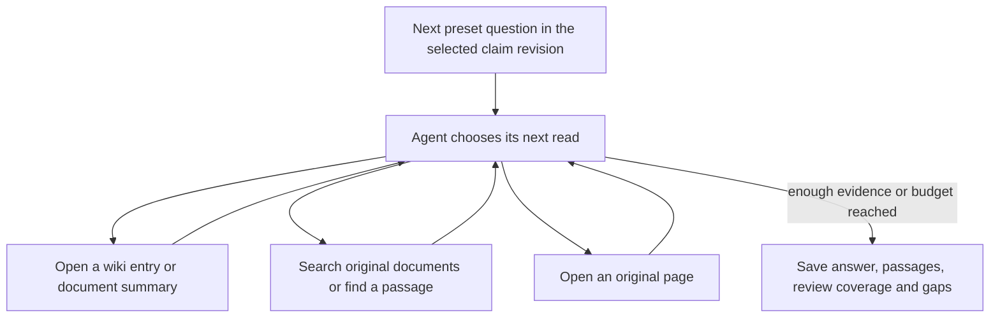

# Generating a report from preset questions

Once the writer publishes the wiki, the research agent takes a claim revision and an ordered preset of subrogation questions. It produces one report with an answer for every question, including any it could only partly answer. The starter preset covers third parties, possible causes, preserved evidence, agreements, amounts, correspondence and open lines of investigation. Subrogation experts can replace it. Each run saves the preset version and exact questions it used. [Starter preset](../presets/subrogation-starter.json)

For the starter question about the connection between a third party and the loss, the water-damage work order places Contractor A at the coupling on 5 May. The insured later suspected roof entry, and the engineer described a coupling leak as one possible explanation. A report can identify Contractor A as a party to investigate while preserving the uncertainty about cause. [Work order](../examples/water-damage/sources/D-02-v1.md#pdf-page-1) · [Insured’s account](../examples/water-damage/sources/D-01-v1.md#pdf-page-1) · [Engineer’s opinion](../examples/water-damage/evidence/D-03-v1/read/citations/p3-507-163-86217db25bf5.pdf#page=3)

The starter question about physical evidence asks where a damaged part was kept and whether photographs exist. Chubb’s burst-pipe recovery example illustrates why both details can matter to an investigator. [Chubb claims FAQ](https://www.chubb.com/ca-en/claims/claims-faq-page.html)

## Retrieval workflow

The agent can start from a wiki issue or search all source documents in the selected claim revision. `search` locates candidate records, `find` locates wording in one record, and `open` reads a wiki page or a numbered source page. For a PDF, search the saved Read text and open the corresponding page of the same searchable PDF the writer received. The original upload is also available for inspection. [PDF ingestion workflow](ingestion.md#pdf-ingestion-workflow)

This loop follows Microsoft’s *AgenticRAG* approach to choosing the next retrieval action from earlier results. The paper also describes summarizing a long session when context fills. Here the claim wiki supplies an additional starting point, and a PDF answer cites the wording of a passage on a specific physical page. [Microsoft Research paper](https://www.microsoft.com/en-us/research/publication/agenticrag-agentic-retrieval-for-enterprise-knowledge-bases/) · [Method and tools](https://arxiv.org/html/2605.05538#S3)

## What the report shows

List the questions in preset order with their original wording, answer, status, source citations and remaining gaps. Include a **Documents reviewed** table for the whole report. Start from the full logical-document inventory for the selected revision so a document still appears when the agent never opened it.

For each question, record the wiki pages consulted, the logical document versions searched, and the physical PDF pages the retrieval tools actually returned to the agent. Flag pages that failed to open or were unreadable. Reading a wiki summary or receiving a search hit counts as a lead. Credit a source page as reviewed when the agent opened it and could read it. Use this report run’s retrieval activity to populate the table. The writer’s earlier reads belong to the wiki build.

For example, suppose a run at `r3` asks **Q1** “Who signed for the work?” and **Q2** “What was the pressure-test result?” The following table illustrates one possible run.

| Document in the revision | Source review in this report | Activity by question |
| --- | --- | --- |
| Loss notice · D-01-v1 | Unreviewed | Q2 searched the notice. No source page was opened. |
| Work order · D-02-v1 | Reviewed in full | Q1 opened p. 1, the entire document. |
| Engineering report · D-03-v1 | Partly reviewed | Q2 opened p. 3. Pages 1–2 were unopened. |

Show the union of pages reviewed across the report and keep the question IDs beside their own reads. Include unreadable page numbers and the reason when known. If a question stopped before relevant pages could be checked, mark its search incomplete and name what remains. In this example Q2 can cite the recommendation on p. 3 and say it has yet to check the remaining records for a result. A whole-file absence claim would exceed its search.

## A recommendation and a missing result

At `r3`, the open action points to the engineering report. Open page 3. The engineer **recommended** a pressure test. Search the available originals for a certificate, a measurement or a later result, and check the other plausible records. After reviewing the three-document file, the answer can say “A test was recommended. No result was found in the documents at this revision.” The citation supports the recommendation. The scope of the completed search explains the gap. [Open action](../examples/water-damage/wiki/action-plan.md) · [Engineering report, p. 3 — “I recommend a pressure test of the supply pipe and connection…”](../examples/water-damage/evidence/D-03-v1/read/citations/p3-686-133-86217db25bf5.pdf#page=3)

If a relevant page was unreadable or the search stopped early, report which evidence still needs checking. Each answer carries its original question, claim revision, supporting passages and any gap. For a PDF passage, the answer uses the same highlighted citation as a wiki entry. [How the citation opens in the PDF](ingestion.md#what-a-pdf-citation-opens) · [How to test the added value of the wiki](evaluation.md)
