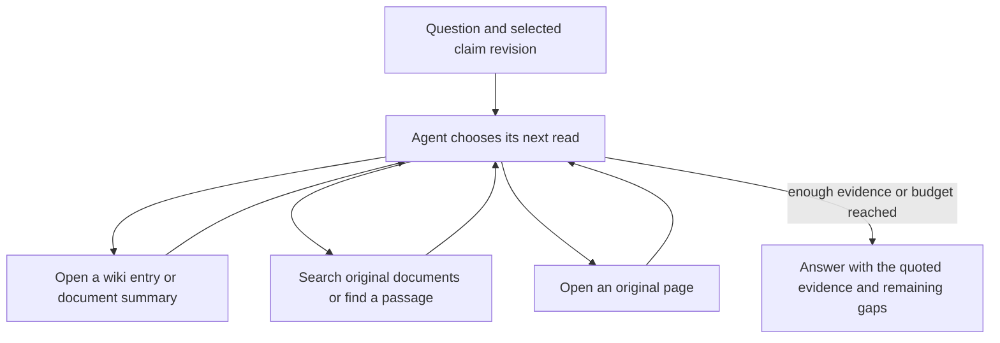

# Answering a question from a claim file

A handler might ask, “Is the pressure-test result on file?” The wiki can identify who requested the test, the words they used and which report to open. The original pages establish what can go into the answer. The idea to test is whether that extra route helps an agent find the right evidence more reliably or with fewer reads.

## Retrieval workflow

The agent can start from a wiki issue or search all source documents in the selected claim revision. `search` locates candidate records, `find` locates wording in one record, and `open` reads a wiki page or a numbered source page. For a PDF, search the saved Read text and open the corresponding page of the same searchable PDF the writer received. The original upload is also available for inspection. [PDF ingestion workflow](ingestion.md#pdf-ingestion-workflow)

This loop follows Microsoft’s *AgenticRAG* approach to choosing the next retrieval action from earlier results. The paper also describes summarizing a long session when context fills. Here the claim wiki supplies an additional starting point, and a PDF answer cites the wording of a passage on a specific physical page. [Microsoft Research paper](https://www.microsoft.com/en-us/research/publication/agenticrag-agentic-retrieval-for-enterprise-knowledge-bases/) · [Method and tools](https://arxiv.org/html/2605.05538#S3)

## A recommendation and a missing result

At `r3`, the open action points to the engineering report. Open page 3. The engineer **recommended** a pressure test. Search the available originals for a certificate, a measurement or a later result, and check the other plausible records. After reviewing the three-document file, the answer can say “A test was recommended. No result was found in the documents at this revision.” The citation supports the recommendation. The scope of the completed search explains the gap. [Open action](../examples/water-damage/wiki/action-plan.md) · [Engineering report, p. 3 — “I recommend a pressure test of the supply pipe and connection…”](../examples/water-damage/evidence/D-03-v1/read/citations/p3-686-133-86217db25bf5.pdf#page=3)

If a relevant page was unreadable or the search stopped early, report which evidence still needs checking. Each answer carries its original question, claim revision, supporting passages and any gap. For a PDF passage, the answer uses the same highlighted citation as a wiki entry. [How the citation opens in the PDF](ingestion.md#what-a-pdf-citation-opens) · [How to test the added value of the wiki](evaluation.md)
