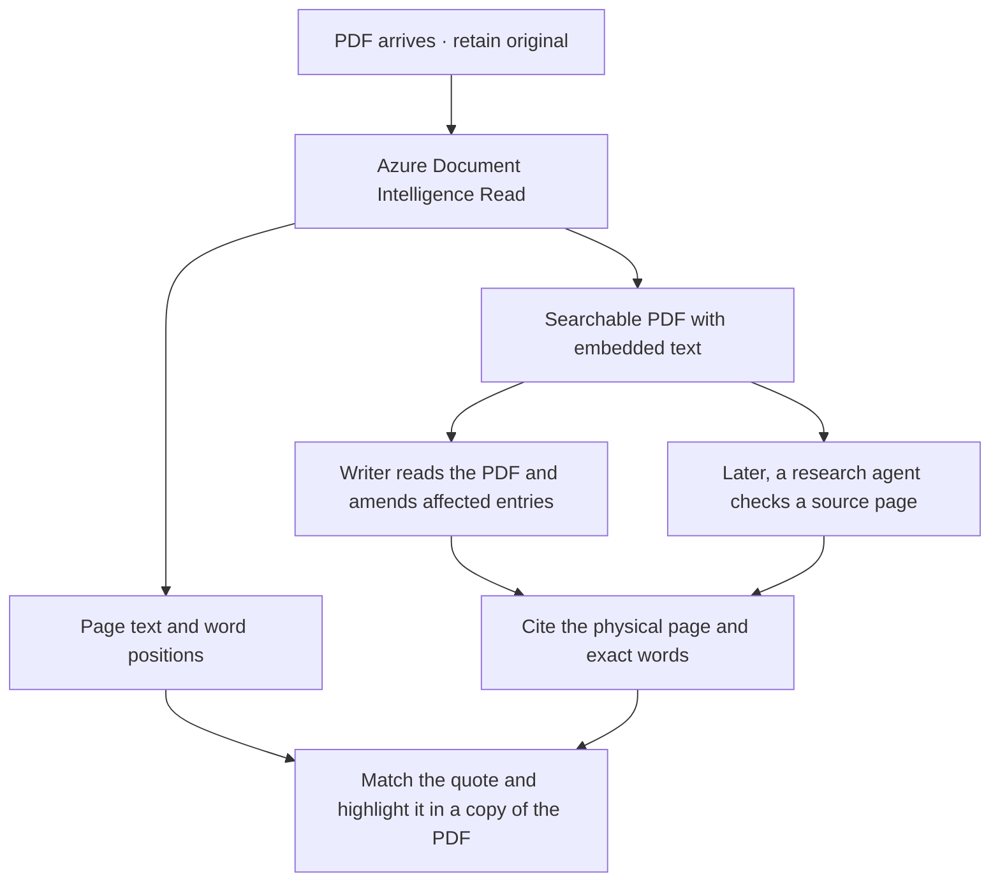

# From incoming document to updated wiki

In the proposed application, a completed upload or folder copy starts ingestion for that claim. For a PDF, the writer’s source is the **searchable PDF returned by Azure Document Intelligence Read**. The same analysis identifies where each word falls on the page.

## PDF ingestion workflow

1. **Keep the original.** Give the upload a document version ID and send its original bytes to `prebuilt-read` with `output=pdf` (API `2024-11-30`).
2. **Collect both results from that operation.** Download Azure’s PDF with its embedded text as `searchable.pdf`. Save the Read result, including physical page numbers, character offsets and word positions, in `read.json`. Keep the pair together for this version. [Microsoft’s searchable PDF documentation](https://learn.microsoft.com/en-us/azure/ai-services/document-intelligence/concept-read?view=doc-intel-4.0.0#searchable-pdfs)
3. **Give the writer the PDF itself.** Attach `searchable.pdf` to the model request with the wiki writing prompt. The writer can read the wording and inspect the page, including diagrams and stamps. When it cites evidence, use `read.json` to locate its quote on that page. [Writing prompt](../prompts/purpose.md) · [Example original scan](../examples/water-damage/sources/D-03-v1.pdf) · [Example writer input](../examples/water-damage/evidence/D-03-v1/read/searchable.pdf)

## Updating the claim wiki

- **First build.** Give one writer the documents already on file. It creates a cited summary per source version, the four claim pages and their index. [Claim page structure](claim-wiki.md)
- **Later arrival.** The writer summarizes the new version, lists it once and opens the entries its evidence could change. It amends the affected wording and cites the page that justifies the change. A routine receipt may need only its summary and inventory links. A conflicting account is attributed alongside the earlier one.

Publish the wiki and inventory together as a revision. A repeat delivery of the same submission returns the saved revision. Earlier handovers remain available. [Storage design](../prototype/data-and-citations.md)

## What a PDF citation opens

The writer supplies the document version, physical page and **exact supporting words**. The citation command matches the quote in the saved extraction and uses the selected words’ positions to create a PDF with that passage highlighted. A wiki footnote and a later research answer can use the same link. Opening it takes the handler to that page with the quotation visible.

For example, the water-damage wiki records a recommendation and leaves the test result open. The highlight shows exactly what the engineer said. [Open action](../examples/water-damage/wiki/action-plan.md) · [Engineering report, p. 3 — “I recommend a pressure test of the supply pipe and connection to help distinguish this possibility from another route of water entry.”](../examples/water-damage/evidence/D-03-v1/read/citations/p3-686-133-86217db25bf5.pdf#page=3)

If the wording occurs twice on a page, select the intended occurrence by its character offset. For evidence spanning pages, cite each page’s passage separately. Review a quote if it fails to match or the extracted wording differs from the visible source. When the page is known but the words cannot be positioned, label the link **Page only**. Other formats use their own source locators. The prototype can prepare one PDF, send it to a writer for a cited source summary and generate its highlights. [Run the PDF commands](../prototype/pdf-citations.md)

## One amendment

The original report recorded the inspection on **12 May**. A signed addendum corrects it to **13 May**. The updated chronology has one inspection entry and cites both records so the handler can trace the change. [Original inspection record, p. 2](../examples/water-damage/evidence/D-03-v1/read/citations/p2-286-98-86217db25bf5.pdf#page=2) · [Signed addendum, p. 1](../examples/water-damage/sources/D-04-v1.md#pdf-page-1)
